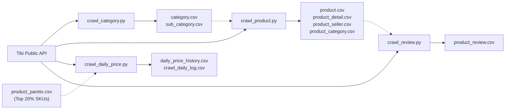

# Tầng Thu Thập Dữ Liệu Tiki (Bronze / Ingestion Layer)

Thư mục này chịu trách nhiệm thu thập toàn bộ dữ liệu thô từ hệ thống API công khai của sàn thương mại điện tử Tiki, lưu trữ dưới dạng các tệp CSV có cấu trúc và sẵn sàng đồng bộ lên **MinIO Object Storage (prefix `current/bronze/`)**.

---

## 1. Cấu trúc và Chi tiết các Crawler



| Nhóm dữ liệu | Script thực thi | Dữ liệu đầu vào | Dữ liệu đầu ra (CSV) | Grain & Ý nghĩa |
|---|---|---|---|---|
| **Category** | `category/crawl_category.py` | Tiki Category API | `category.csv`<br/>`sub_category.csv` | Danh mục gốc (cấp 1) và cây phân cấp danh mục con (cấp 1 đến cấp 5). Nguồn dữ liệu tương đối tĩnh, crawl khi khởi tạo hệ thống. |
| **Product** | `product/crawl_product.py` | `category/category.csv` | `product.csv`<br/>`product_detail.csv`<br/>`product_seller.csv`<br/>`product_category.csv` | **Snapshot theo tháng (`YYYY-MM`)**:<br/>- `product.csv`: Danh sách cặp `(product_id, seller_product_id)`.<br/>- `product_detail.csv`: Thuộc tính chi tiết (SKU, brand, rating, sold).<br/>- `product_seller.csv`: Gian hàng, giá bán, cờ `is_best_store`.<br/>- `product_category.csv`: Cây breadcrumb liên kết sản phẩm - danh mục. |
| **Daily Price** | `daily_price/crawl_daily_price.py`<br/>`daily_price/recovery.py` | `daily_price/product_pareto.csv` | `daily_price_history.csv`<br/>`crawl_daily_log.csv` | **Lịch sử biến động giá theo ngày (`YYYY-MM-DD`)** của các sản phẩm trọng tâm (Pareto 80/20). Ghi nhận giá bán, giá niêm yết, tỷ lệ giảm giá và tồn kho. |
| **Review** | `review/crawl_review.py` | `product/product_detail.csv`<br/>`product/product_seller.csv` | `product_review.csv` | Đánh giá khách hàng lũy kế. Nhận diện duy nhất bằng bộ ba khóa: `(review_id, product_id, seller_product_id)`. |

---

## 2. Cơ chế Vận hành Thông minh & Chống lỗi (Fault Tolerance)

1. **Khả năng tiếp tục khi bị ngắt quãng (Resumable Crawl)**:
   - Các crawler định kỳ flush dữ liệu từ bộ nhớ xuống đĩa (`SAVE_EVERY`), không sợ mất dữ liệu nếu tiến trình bị kill giữa chừng.
   - `crawl_daily_price.py` tự động đối soát với các khóa thành công đã có trong `daily_price_history.csv` của ngày chạy (`crawl_date`), chỉ crawl các ID còn thiếu.
   - `crawl_review.py` duyệt theo thứ tự thời gian mới nhất; khi gặp review đã có trong file thì tự động dừng quét cho sản phẩm đó để tiết kiệm request.
2. **Xử lý Rate Limit & Thoát mã lỗi (Exit Code)**:
   - Áp dụng thời gian chờ ngẫu nhiên (`REQUEST_DELAY`) và cơ chế Exponential Backoff khi gặp mã lỗi HTTP `429 Too Many Requests` hoặc `5xx Server Error`.
   - Nếu bị sàn chặn (HTTP 401, 403, 429 kéo dài), script sẽ **thoát với mã lỗi `sys.exit(1)`**. Điều này giúp Airflow ghi nhận task thất bại và kích hoạt cơ chế retry tự động theo lịch thay vì báo thành công giả tạo.
3. **Cơ chế lưu trữ lũy kế**:
   - `daily_price_history.csv` và `product_review.csv` được ghi nối tiếp (`mode="a"`), bảo tồn toàn bộ dữ liệu lịch sử của các đợt crawl trước đó.

---

## 3. Điều phối qua Airflow (Orchestration)

Khi chạy trong môi trường Docker / Airflow, các crawler được điều phối tự động qua adapter `04_orchestration/airflow/scripts/minio_task.py`:

* **DAG Monthly (`tiki_product_monthly`)**:
  - Kích hoạt lúc **02:00 ngày 1 hàng tháng**.
  - Thực thi: `crawl_product.py` quét toàn bộ danh mục và crawl chi tiết sản phẩm tháng mới (`execution_timeout=144h`).
* **DAG Daily (`tiki_extract_transform_load`)**:
  - **03:00**: `crawl_product.py` quét bổ sung sản phẩm mới xuất hiện (tự động skip nếu DAG monthly đang chạy).
  - **09:00**: `crawl_review.py` thu thập các đánh giá mới phát sinh.
  - **14:00**: `crawl_daily_price.py` lượt crawl giá chính trong ngày.
  - **21:00**: `crawl_daily_price.py` đọc log lỗi trong ngày, crawl bù các SKU/variant chưa thành công.

Sau mỗi lượt crawl hoàn tất, adapter sẽ tính mã băm SHA-256 và đồng bộ các file CSV có thay đổi lên MinIO Bronze (`current/bronze/`), đồng thời sao lưu bản cũ vào `history/<run_id>/bronze/`.

---

## 4. Hướng dẫn Chạy Thủ công (Manual Execution)

Nếu muốn chạy trực tiếp bằng dòng lệnh không qua Airflow, đứng từ thư mục gốc của repository (`TiKi-Analysic`):

```bash
# 1. Crawl danh mục (chạy một lần ban đầu)
python 01_craw_data/category/crawl_category.py

# 2. Crawl sản phẩm và chi tiết thuộc tính
python 01_craw_data/product/crawl_product.py

# 3. Crawl giá hàng ngày (cần file product_pareto.csv)
python 01_craw_data/daily_price/crawl_daily_price.py

# 4. Crawl đánh giá khách hàng (cần dữ liệu product_detail và product_seller)
python 01_craw_data/review/crawl_review.py
```

> **Lưu ý**: Chạy thủ công bằng lệnh trên chỉ cập nhật dữ liệu CSV tại máy local. Để nạp dữ liệu vào cơ sở dữ liệu phân tích, cần tiếp tục chạy tầng Tiền xử lý (`02_process_raw_data`) và Nạp dữ liệu (`03_push_to_sql`).
