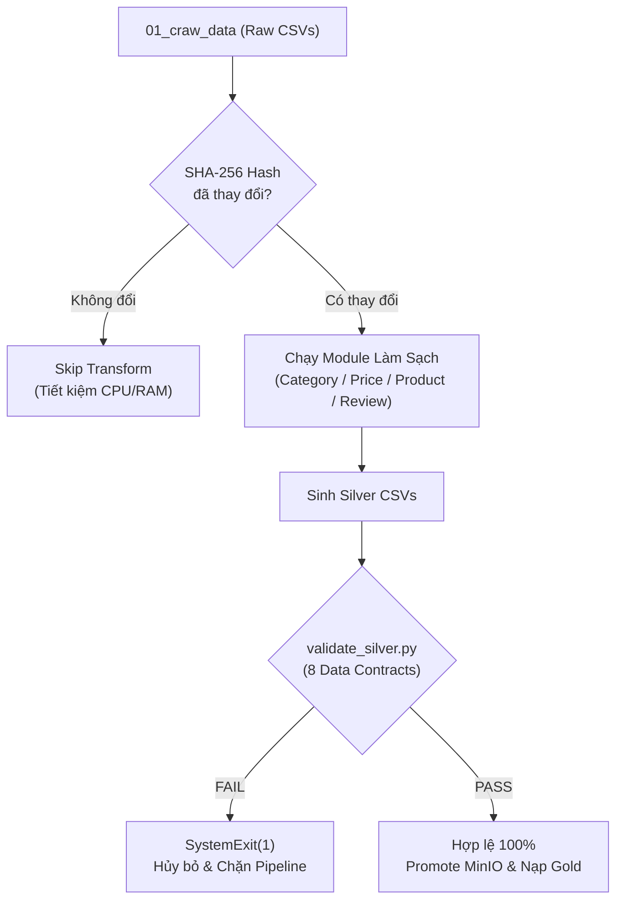

# Tầng Tiền Xử Lý & Làm Sạch Dữ Liệu (Silver / Transform Layer)

Thư mục này chịu trách nhiệm đọc dữ liệu thô (Bronze) từ `01_craw_data/`, thực hiện làm sạch dữ liệu (Data Cleaning), chuẩn hóa kiểu dữ liệu, khử trùng lặp và kiểm định chất lượng nghiêm ngặt (Data Contracts) trước khi đồng bộ lên **MinIO Object Storage (prefix `current/silver/`)**.

---

## 1. Chi tiết các Module Tiền Xử Lý

| Module | Tập tin đầu vào (Bronze) | Tập tin đầu ra (Silver) | Nghiệp vụ làm sạch & chuẩn hóa dữ liệu |
|---|---|---|---|
| **Category** | `01_craw_data/category/*.csv` | `02_process_raw_data/category/category.csv`<br/>`sub_category.csv` | - Chuẩn hóa chuỗi văn bản, loại bỏ khoảng trắng thừa.<br/>- Ép kiểu ID sang số nguyên an toàn (`Int64`), loại bỏ dòng lỗi.<br/>- Khử trùng lặp trên `category_id`. |
| **Daily Price** | `01_craw_data/daily_price/daily_price_history.csv` | `02_process_raw_data/daily_price/daily_price_history.csv` | - **Chuẩn hóa giá**: Loại bỏ hoàn toàn bản ghi có `price <= 0` hoặc rỗng để tránh làm lệch chỉ số giá trung bình (ASP).<br/>- **Fallback giá niêm yết**: Nếu thiếu `list_price` / `original_price` thì điền bằng `price`.<br/>- **Chuẩn hóa giảm giá**: Tính toán lại `discount = list_price - price` và `discount_rate` trong khoảng `[0, 100]`.<br/>- **Khử trùng lặp**: Đảm bảo duy nhất trên bộ ba `(product_id, seller_product_id, crawl_date)`. Nối tiếp dữ liệu lịch sử các ngày. |
| **Product** | `01_craw_data/product/*.csv` | `02_process_raw_data/product/product.csv`<br/>`product_detail.csv`<br/>`product_seller.csv`<br/>`product_category.csv` | - **Lọc snapshot tháng hiện tại**: Giữ các bản ghi có `crawl_date` thuộc tháng thực thi (`YYYY-MM`).<br/>- **Chuẩn hóa thương hiệu**: Gán nhãn `'Không thương hiệu'` cho các trường hợp thiếu tên hoặc giá trị OEM, No Brand.<br/>- **Giới hạn số học**: Rating được đưa về khoảng `[0.0, 5.0]`, số lượng bán và lượt thích được điền mặc định 0 nếu rỗng.<br/>- Khử trùng lặp theo khóa chính của từng bảng. |
| **Review** | `01_craw_data/review/product_review.csv` | `02_process_raw_data/review/product_review.csv` | - **Xử lý theo khối (Chunking)**: Duyệt từng khối **150.000 dòng** để tối ưu bộ nhớ RAM khi dữ liệu đạt hàng triệu bản ghi.<br/>- **Bảo toàn tính trung thực của Rating**: Lọc bỏ các dòng thiếu rating hoặc ngoài khoảng `[1, 5]`, tuyệt đối không tự tiện điền mặc định 5 sao.<br/>- **Lọc trùng theo bộ 3 khóa kết hợp**: Chỉ nối các review mới chưa từng xuất hiện theo `(review_id, product_id, seller_product_id)`. |

---

## 2. Master Pipeline & Cơ chế Tối ưu Băm SHA-256



Script điều phối tổng [`run_all_preprocessing.py`](run_all_preprocessing.py) thực thi tuần tự 4 module trên với cơ chế tối ưu hiệu năng:
* Trước khi chạy một module, script tính toán mã băm SHA-256 của toàn bộ tệp đầu vào và so sánh với lịch sử lưu tại `.preprocessing_state.json`.
* **Nếu dữ liệu thô không có dòng mới**: Script tự động **Skip** module đó, giúp tiết kiệm tối đa thời gian xử lý và tài nguyên CPU.
* **Ghi tệp an toàn (Atomic File Replace)**: Sử dụng tệp tạm `.tmp` và `os.replace` để bảo đảm tệp state không bị hỏng nếu bị ngắt tiến trình đột ngột.

---

## 3. Kiểm Định Hợp Đồng Dữ Liệu (Data Contract Validation)

Script [`validate_silver.py`](validate_silver.py) là **chốt chặn chất lượng dữ liệu** bắt buộc trước khi dữ liệu được phép nạp vào kho Gold (PostgreSQL). Nó kiểm tra 8 hợp đồng dữ liệu nghiêm ngặt:

1. **Required Columns**: Đầy đủ các cột bắt buộc theo schema.
2. **Key Integrity**: Cột khóa không được phép chứa giá trị rỗng (Null/Blank).
3. **Uniqueness**: Không có bất kỳ bản ghi nào bị trùng lặp khóa chính / khóa duy nhất.
4. **Format Dates**: Cột ngày phải đúng định dạng (`YYYY-MM-DD` cho Daily Price, `YYYY-MM` cho Product snapshot).
5. **Value Range**: Kiểm tra khoảng giá trị hợp lệ (ví dụ: `price > 0`, `rating BETWEEN 1 AND 5`, `discount_rate BETWEEN 0 AND 100`).

> ⚠️ **Quy tắc chặn**: Nếu bất kỳ tệp CSV nào vi phạm hợp đồng, `validate_silver.py` sẽ **báo lỗi và thoát với mã `SystemExit(1)`**, chặn toàn bộ quá trình Promote dữ liệu lên MinIO và ngăn chặn nạp dữ liệu rác vào Supabase.

---

## 4. Điều phối qua Airflow & Cơ chế Staging

Trong hệ thống Docker / Airflow:
1. Task `run_preprocessing` chạy script `run_all_preprocessing.py`. Dữ liệu mới được tải lên vùng tạm của MinIO (`staging/<run_id>/silver/`) kèm tệp manifest `_complete.json`.
2. Task `validate_silver_data` tải dữ liệu từ vùng tạm xuống và chạy `validate_silver.py`.
3. Chỉ khi bước kiểm định đạt 100% tiêu chuẩn, adapter `minio_task.py` mới thực hiện **Atomic Promotion**: sao lưu bản Silver cũ vào `history/<run_id>/silver/` và đưa bản mới vào `current/silver/`.
4. Cả 2 task đều được bảo vệ bởi Airflow Pool `tiki_sync_pool` (1 slot) để đảm bảo không bị xung đột tài nguyên giữa các DAG.

---

## 5. Hướng dẫn Chạy Thủ công

Đứng từ thư mục gốc của repository:

```bash
# 1. Chạy toàn bộ quy trình tiền xử lý 4 module
python 02_process_raw_data/run_all_preprocessing.py

# 2. Hoặc có thể chạy riêng lẻ từng module khi cần:
python 02_process_raw_data/category/process_category.py
python 02_process_raw_data/daily_price/process_daily_price.py
python 02_process_raw_data/product/process_product.py
python 02_process_raw_data/review/process_review.py

# 3. Kiểm định chất lượng dữ liệu Silver sau khi làm sạch
python 02_process_raw_data/validate_silver.py
```
