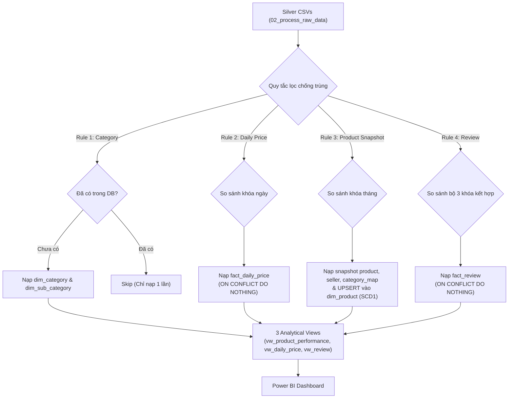

# Tầng Kho Dữ Liệu & Phân Tích (Gold / Load Layer)

Thư mục này chịu trách nhiệm nạp dữ liệu sạch từ tầng Silver (`02_process_raw_data/`) vào cơ sở dữ liệu **Supabase PostgreSQL** theo mô hình kho dữ liệu **Star Schema**, cung cấp các bảng Fact, Dimension và Analytical Views tối ưu hóa cho **Power BI Desktop** và phân tích kinh doanh (Business Intelligence).

---

## 1. Cấu trúc Thư Mục

* [`create_tables_postgres.sql`](create_tables_postgres.sql): Tệp DDL định nghĩa toàn bộ cấu trúc bảng vật lý, khóa chính, khóa ngoại, chỉ mục (Indexes), ràng buộc kiểm tra (Check Constraints) và các View phân tích.
* [`push_to_database.py`](push_to_database.py): Script thực thi tiến trình nạp dữ liệu thông minh (Smart Incremental Loader) với cơ chế bảo đảm an toàn và không gây trùng lặp.
* `sync_checkpoint_supabase.json`: Tệp lưu vết tiến độ đồng bộ (thời gian nạp gần nhất, danh sách ngày giá đã nạp, số lượng khóa review; tự động khởi tạo khi chạy và được adapter đồng bộ lên MinIO `current/state/`).
* `logs/`: Thư mục lưu vết nhật ký chi tiết của từng phiên nạp dữ liệu.

---

## 2. Quy Tắc Nạp Dữ Liệu Thông Minh (Smart Incremental Load)



Script `push_to_database.py` áp dụng cơ chế nạp gia tăng với **4 quy tắc lọc chống trùng** khắt khe:

| Nhóm dữ liệu | Bảng đích (PostgreSQL) | Cơ chế so sánh & nạp an toàn |
|---|---|---|
| **1. Category** | `dim_category`<br/>`dim_sub_category` | **Chỉ nạp 1 lần duy nhất**: Kiểm tra trạng thái trong checkpoint và kiểm tra dữ liệu hiện có trong bảng. Nếu đã có dữ liệu, script tự động bỏ qua để tiết kiệm tài nguyên. |
| **2. Daily Price** | `fact_daily_price` | **Đối chiếu từng khóa với Database**: Đọc danh sách khóa `(product_id, seller_product_id, crawl_date)` từ database về bộ nhớ, chỉ nạp các dòng có khóa mới. Chèn dữ liệu bằng lệnh `ON CONFLICT DO NOTHING`. |
| **3. Monthly Snapshot** | `dim_product_listing`<br/>`product_detail`<br/>`product_seller`<br/>`product_category_map`<br/>`dim_product` | **So sánh snapshot tháng**: Đối chiếu các khóa snapshot theo tháng (`YYYY-MM`). Sau khi nạp lịch sử vào `product_detail`, script tự động chạy câu lệnh `UPSERT` để cập nhật trạng thái mới nhất của từng sản phẩm vào Dimension `dim_product` (SCD Type 1). |
| **4. Review** | `fact_review` | **Lọc theo bộ 3 khóa kết hợp (Composite Key)**: Lọc chính xác theo `(review_id, product_id, seller_product_id)`. Đảm bảo độ chính xác tuyệt đối, không bao giờ bị nhận diện nhầm giữa các biến thể hoặc các gian hàng khác nhau. |

> 🛡️ **Bảo đảm tính Idempotent**: Toàn bộ thao tác chèn bản ghi sử dụng phương thức `insert_ignore_conflicts` (`pg_insert().on_conflict_do_nothing()`). Nếu pipeline bị ngắt quãng và chạy lại, dữ liệu tuyệt đối không bao giờ bị nhân đôi dòng (duplicate rows).

---

## 3. Các View Phân Tích Dành Riêng Cho Power BI (Data Mart)

Trong [`create_tables_postgres.sql`](create_tables_postgres.sql) đã xây dựng sẵn 3 View phân tích chuyên sâu:

1. **`vw_product_performance`**: Bảng tổng hợp hiệu suất toàn diện cho Dashboard Executive Summary.
   * Cung cấp: Doanh thu ước tính (`all_time_quantity_sold * price`), sản lượng bán, giá bán mới nhất, giá niêm yết, tỷ lệ giảm giá, tên thương hiệu, tên ngành hàng.
2. **`vw_daily_price_analysis`**: Bảng theo dõi xu hướng biến động giá theo thời gian.
   * Cung cấp: Giá bán hàng ngày, giá niêm yết, discount, discount rate kết hợp với tên sản phẩm, thương hiệu và ngành hàng cha.
3. **`vw_review_analysis`**: Bảng phân tích trải nghiệm và đánh giá của khách hàng.
   * Cung cấp: Điểm rating (1-5 sao), tiêu đề, nội dung review, cờ xác thực mua hàng (`purchased`), cờ có ảnh (`is_photo`), số lượt cảm ơn (`thank_count`), tên sản phẩm và thương hiệu.

---

## 4. Kết Nối Power BI Desktop & Xây Dựng Báo Cáo

1. Mở **Power BI Desktop** ➔ Chọn **Get data** ➔ **PostgreSQL database**.
2. Lấy thông tin kết nối từ Supabase Dashboard (**Project Settings ➔ Database ➔ Connection String**):
   * **Server**: `<db.project-id.supabase.co>:<port>`
   * **Database**: `postgres`
   * **Data Connectivity mode**: Chọn **Import** (khuyến nghị chế độ Import để tăng tốc độ truy vấn, hạn chế mở kết nối kéo dài tới database).
3. Đăng nhập bằng tài khoản và mật khẩu của database Supabase.
4. Chọn 3 View phân tích (`vw_product_performance`, `vw_daily_price_analysis`, `vw_review_analysis`) hoặc chọn các bảng Dimension/Fact để tự xây dựng mối quan hệ trong Data Model view.
5. Nhấn **Refresh** trên thanh công cụ bất kỳ lúc nào để cập nhật dữ liệu mới nhất sau khi Airflow chạy xong.

---

## 5. Hướng Dẫn Chạy Thủ Công

Đứng từ thư mục gốc của repository, đảm bảo biến môi trường `SUPABASE_DB_URL` đã được cấu hình trong tệp `.env`:

```bash
# Thực thi nạp toàn bộ dữ liệu sạch từ 02_process_raw_data lên Supabase
python 03_push_to_sql/push_to_database.py
```

> 💡 Trong môi trường tự động hóa, task này tương ứng với task `load_new_rows_to_supabase` trong cả 2 DAG của Airflow, và luôn được bảo vệ bởi Airflow Pool `tiki_sync_pool` (1 slot) để đảm bảo không bị ghi đè dữ liệu đồng thời.
