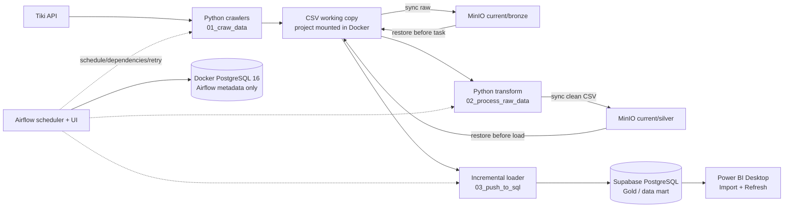

# Tiki Analytics — hướng dẫn từ A đến Z

Dự án phân tích dữ liệu Tiki theo luồng **crawl → lưu raw → làm sạch → lưu dữ liệu sạch → nạp PostgreSQL → báo cáo Power BI**. Airflow và MinIO chạy local bằng Docker Desktop; Supabase PostgreSQL là kho dữ liệu phân tích.

## Kiến trúc



Bronze/Silver ở đây là các prefix lưu CSV/JSON trên MinIO, không phải bảng SQL. Adapter tải object `current` cần thiết về working copy, chạy script hiện có, rồi đồng bộ file đổi lên MinIO; phiên bản cũ được lưu dưới `history/<run-id>/...`. Gold là các bảng/view Supabase. PostgreSQL trong Docker chỉ giữ trạng thái Airflow, không chứa dữ liệu Tiki. Power BI kết nối Supabase, không đọc trực tiếp MinIO.

## Công cụ và vai trò

| Công cụ | Vai trò |
|---|---|
| Docker Desktop + WSL2 | Chạy các service local trên Windows. |
| Airflow 2.10.5 | Lập lịch DAG, điều phối task, retry, trạng thái và log. |
| PostgreSQL 16 (`airflow-db`) | Metadata nội bộ của Airflow. |
| MinIO AIStor | S3 object storage cho Bronze, Silver, checkpoint và history. |
| Python 3.11 | Runtime crawler, transform, adapter và loader trong container. |
| Supabase PostgreSQL | Dữ liệu phân tích và views cho BI. |
| Power BI Desktop | Model, visual, report và refresh dữ liệu. |
| Git/Git LFS | Source code và một số CSV nguồn lớn; dữ liệu chạy mới không tự đẩy về GitHub. |

## Luồng làm việc

1. Airflow khởi tạo DAG run theo lịch hoặc cấu hình trigger thủ công.
2. `minio_task.py` kiểm tra bucket, tải dữ liệu `current` liên quan về working copy trong container.
3. Crawler gọi Tiki và ghi CSV raw vào `01_craw_data/`; adapter đồng bộ lên `current/bronze/`.
4. Transform chuẩn hóa raw thành CSV trong `02_process_raw_data/`; adapter đồng bộ lên `current/silver/`.
5. Kiểm tra schema, khóa, trùng lặp và miền giá trị của Silver trước khi load.
6. Loader đọc CSV hợp lệ, chỉ thêm khóa mới vào Supabase, cập nhật `dim_product` theo snapshot mới nhất và đồng bộ checkpoint vào `current/state/`.
7. Sau khi task load thành công, Power BI refresh từ Supabase.

Thấy DAG run hoàn tất chưa đủ để khẳng định DB đã có dữ liệu: cần xem task `load_new_rows_to_supabase` thành công và kiểm tra row count. Một manual trigger không có `conf` có thể không chọn nhánh crawl; dùng config như hướng dẫn dưới.

## Cấu trúc repository

| Thư mục/file | Vai trò |
|---|---|
| `01_craw_data/` | Crawler và CSV raw/nguồn khởi tạo. |
| `02_process_raw_data/` | Làm sạch, chuẩn hóa, CSV silver. |
| `03_push_to_sql/create_database/` | DDL bảng, index và views. |
| `03_push_to_sql/push_to_sql/` | Loader incremental, checkpoint, log. |
| `04_orchestration/airflow/dags/` | DAG Airflow. |
| `04_orchestration/airflow/scripts/minio_task.py` | Sync dữ liệu giữa working copy và MinIO. |
| `04_orchestration/airflow/docker-compose.yml` | Khai báo Airflow, MinIO và Postgres metadata. |

CSV trong Git/LFS là dữ liệu khởi tạo/tham khảo. MinIO là nơi lưu bền dữ liệu phát sinh trong pipeline. Repository hiện không kèm Power BI `.pbix`; báo cáo được tạo trong Power BI Desktop sau khi nạp dữ liệu.

## Mô hình dữ liệu: bảng, dòng, cột

**Bảng** chứa các bản ghi cùng cấu trúc. **Dòng (row/grain)** là một đối tượng hoặc quan sát ở mức chi tiết cụ thể. **Cột (column)** là thuộc tính của dòng. Khóa xác định một bản ghi duy nhất; `dim_*` mô tả thực thể, `fact_*` ghi sự kiện/quan sát, còn `product_*` lưu snapshot hoặc quan hệ.

| Bảng | Một dòng đại diện cho | Cột/khóa và ý nghĩa |
|---|---|---|
| `dim_category` | Một danh mục Tiki. | `category_id` mã Tiki/PK; `name` tên; `urlKey` slug; `src` nguồn/nhóm; `created_at` lúc tạo trong DB. |
| `dim_sub_category` | Một đường phân cấp con của danh mục cha. | `category_id` cha/FK; `category_name`; các cặp `sub_category_1_id`/`sub_category_1` … `_5` là ID/tên từng cấp; `id` là ID DB tự tăng; cấp thiếu có thể NULL. |
| `dim_product_listing` | Sản phẩm/biến thể xuất hiện trong danh mục ở snapshot tháng. | `product_id`, `seller_product_id`, `category_id`, `crawl_date` (`YYYY-MM`); bốn cột tạo khóa chính. |
| `product_detail` | Thuộc tính sản phẩm ở một tháng snapshot. | PK `(product_id,crawl_date)`; `master_id` nhóm/cha; `sku`; `product_name`, `product_type`, `url_key`; `created_date` từ nguồn; `favourite_count`; `brand_id`, `brand_name`; `rating_average`, `review_count`, `all_time_quantity_sold`; `updated_at` lúc ghi DB. Giữ lịch sử theo tháng. |
| `dim_product` | Phiên bản mới nhất của một `product_id`. | Thuộc tính sản phẩm tương tự `product_detail`; `latest_crawl_month` là snapshot được dùng; `updated_at` lúc đồng bộ. Không thay lịch sử `product_detail`. |
| `product_seller` | Quan hệ sản phẩm/biến thể với seller trong snapshot tháng. | `product_id`, `seller_product_id`, `seller_id`; `seller_name`, `seller_link`, `store_id`, `seller_price`; `is_current_seller`, `is_best_store`; `crawl_date`; `id` tự tăng. Unique theo sản phẩm/biến thể/seller/tháng (NULL seller được chuẩn hóa). |
| `product_category_map` | Liên kết sản phẩm-danh mục trong tháng. | `product_id`, `category_id`, `category_name`, `category_level`, `category_url`, `is_leaf`, `is_primary`, `crawl_date`; unique `(product_id,category_id,crawl_date)`, `id` tự tăng. |
| `fact_daily_price` | Giá/chỉ số của một biến thể trong một ngày crawl. | `product_id`, `seller_product_id`, `seller_id`, `category_id`; `crawl_date` ngày quan sát; `price`, `list_price`, `original_price`, `discount`, `discount_rate`; `rating_average`, `review_count`, `all_time_quantity_sold` tại lúc crawl; `inventory_status`. Unique `(product_id,seller_product_id,crawl_date)`, `id` tự tăng. |
| `fact_review` | Một review gắn với sản phẩm/biến thể. | PK `(review_id,product_id,seller_product_id)`; `seller_id`; `rating` 1–5; `title`, `content`; `review_created_at` lúc review tạo; `purchased`; `thank_count`, `comment_count`, `is_photo`; `crawl_time` lúc crawl. |

| View | Nội dung |
|---|---|
| `vw_daily_price_analysis` | Các cột giá cộng `product_name`, `brand_name`, `product_type` từ `dim_product`, LEFT JOIN theo `product_id`. |
| `vw_review_analysis` | Các cột review cộng tên/brand/type từ `dim_product`. |

Product `crawl_date` là tháng `YYYY-MM`; daily price `crawl_date` là ngày `YYYY-MM-DD`. Đây là thời điểm snapshot, không phải ngày tạo sản phẩm/review. `id` tự tăng là ID DB, không phải ID Tiki. Kiểu dữ liệu, nullability, constraint và index được định nghĩa đầy đủ trong [SQL schema](03_push_to_sql/create_database/create_tables_postgres.sql).

## Chạy từ đầu bằng Docker trên Windows

### 1. Điều kiện và source code

Cài Docker Desktop, bật WSL2; kiểm tra `docker --version`, `docker compose version`, `docker run hello-world`. Lấy repository và file Git LFS:

```cmd
cd /d D:\
git clone https://github.com/tuan-anh-05/TiKi-Analysic.git
cd /d D:\TiKi-Analysic
git lfs install
git lfs pull
```

Nếu đã clone repo thì chỉ `cd /d D:\TiKi-Analysic` và `git lfs pull`. Chọn branch có cấu hình triển khai nếu chưa nằm trên branch mặc định.

Tải MinIO AIStor Free Tier license hợp lệ, đặt thành `04_orchestration\airflow\minio.license`. Cần một Supabase project; Power BI Desktop chỉ cần khi làm báo cáo.

### 2. Tạo `.env`

```cmd
cd /d D:\TiKi-Analysic\04_orchestration\airflow
copy .env.example .env
notepad .env
```

Thay toàn bộ placeholder: `AIRFLOW_ADMIN_USER` là user Airflow; `AIRFLOW_ADMIN_PASSWORD` là mật khẩu local; `AIRFLOW_DB_PASSWORD` là mật khẩu riêng Postgres Airflow (nên chữ/số, không phải Supabase); `AIRFLOW_SECRET_KEY` là chuỗi random riêng; `MINIO_ROOT_USER`/`MINIO_ROOT_PASSWORD` là tài khoản quản trị MinIO; `MINIO_BUCKET` mặc định `tiki-lake`; `MINIO_ACCESS_KEY`/`MINIO_SECRET_KEY` là key app sẽ tạo trong MinIO; `SUPABASE_DB_URL` lấy tại Supabase Connect với password thật và SSL. Ký tự đặc biệt của password trong connection URL phải percent-encode. Không đưa `.env`, password hoặc license lên Git.

Tạo `AIRFLOW_FERNET_KEY` bằng Python:

```cmd
python -c "import base64,secrets; print(base64.urlsafe_b64encode(secrets.token_bytes(32)).decode())"
```

Copy kết quả vào `.env`. Không để lại giá trị `change-this`, `replace-with`, `YOUR_PASSWORD` hoặc `YOUR_PROJECT`.

### 3. Khởi tạo Airflow và chạy services

Tại `04_orchestration\airflow`:

```cmd
docker compose build
docker compose up airflow-init
docker compose up -d
docker compose ps
```

Chờ các service `airflow-db`, `minio`, `airflow-webserver`, `airflow-scheduler` chạy. Mở Airflow [http://localhost:8080](http://localhost:8080) bằng Airflow user/password. MinIO Console [http://localhost:9001](http://localhost:9001) dùng root credential. S3 endpoint nội bộ Docker là `http://minio:9000`.

### 4. Bucket, access key, schema và bootstrap

Trong MinIO Console tạo bucket đúng tên `MINIO_BUCKET`; tạo access key riêng cho ứng dụng với quyền list/get/read/put/write/copy object trên bucket, lưu secret. Điền key/secret vào `.env`, rồi:

```cmd
docker compose up -d --force-recreate airflow-webserver airflow-scheduler
```

Trong Supabase Dashboard → SQL Editor chạy một lần nội dung [`create_tables_postgres.sql`](03_push_to_sql/create_database/create_tables_postgres.sql). Loader cũng chạy DDL, nhưng `IF NOT EXISTS` không migrate bảng cũ.

Nạp CSV/JSON hiện có vào MinIO một lần:

```cmd
docker compose run --rm airflow-webserver python /opt/tiki/project/04_orchestration/airflow/scripts/minio_task.py bootstrap
```

Bootstrap chỉ seed object chưa có, không gọi crawler Tiki.

### 5. Trigger pipeline và xác nhận dữ liệu

Bật DAG `tiki_extract_transform_load`. Chọn **Trigger DAG w/ config** và nhập:

```json
{"task":"daily_price"}
```

Các task conf hợp lệ: `daily_price`, `product`, `review`, `preprocess`, `push`. Có thể trigger từ terminal trong thư mục Compose:

```cmd
docker compose exec airflow-scheduler airflow dags trigger --conf "{\"task\":\"daily_price\"}" tiki_extract_transform_load
```

Lượt manual crawl tiếp tục transform và load; `preprocess` chạy transform rồi load; `push` cũng chạy preprocess trước khi load. Mở Grid/Graph, xem log và xác nhận `crawl_*`, `run_preprocessing`, `load_new_rows_to_supabase` thành công. Sau đó kiểm tra MinIO prefix `current/bronze/`, `current/silver/`, `current/state/` và row count/view trong Supabase.

Lệnh chẩn đoán:

```cmd
docker compose exec airflow-scheduler airflow dags list
docker compose exec airflow-scheduler airflow dags list-import-errors
docker compose logs -f airflow-scheduler
docker compose logs -f minio
```

### 6. Kết nối Power BI và xem report

Power BI Desktop → **Get data → PostgreSQL database**. Host/port/database/user lấy từ Supabase **Connect**; database thường `postgres`; bật SSL/Require; nhập DB password. Chọn **Import** để giảm kết nối mở lâu, chọn hai view `vw_daily_price_analysis`, `vw_review_analysis` để bắt đầu, hoặc chọn bảng riêng để tự model. Tạo biểu đồ giá theo ngày/brand, discount, review rating và sản phẩm theo category. Khi loader thành công, nhấn **Refresh**. Repo chưa có `.pbix` dựng sẵn, nên cần tự tạo report; publish/refresh Power BI Service là bước ngoài stack local.

## Lịch tự động (giờ Việt Nam — Asia/Ho_Chi_Minh)

Tất cả thời gian dưới đây theo giờ Việt Nam (`Asia/Ho_Chi_Minh`, UTC+7).

| Giờ kích hoạt | Task chạy theo lịch | Ghi chú |
|---|---|---|
| 02:00 | Crawl product ngày lẻ; crawl review ngày chẵn | Ngày được tính theo lịch Việt Nam. Sau crawl chạy ETL đầy đủ. |
| 10:00 | Crawl product ngày lẻ; crawl review ngày chẵn | Ngày được tính theo lịch Việt Nam. Sau crawl chạy ETL đầy đủ. |
| 18:00 | Crawl giá (`daily_price`) | Crawl lượt đầu; nối kết quả theo ngày vào `daily_price_history.csv`, đồng bộ Bronze rồi chạy ETL đầy đủ. |
| 21:00 | Crawl tiếp giá (`daily_price`) | Đọc log lỗi trong ngày, retry các product/variant lỗi hoặc còn thiếu và append vào chính file ngày đó; đồng bộ Bronze rồi chạy ETL đầy đủ. |

Trong mỗi lượt có crawl: dữ liệu raw được đồng bộ vào MinIO Bronze ngay khi crawler kết thúc; tiếp đó DAG transform ra Silver, kiểm tra Silver, rồi mới nạp Gold vào Supabase. Nếu crawl, transform hoặc kiểm tra thất bại sau các lần retry, các bước phía sau không chạy. Daily price giữ grain một bản ghi/sản phẩm/ngày: bản ghi thành công lúc 18:00 không bị thay; 21:00 chỉ bổ sung sản phẩm/biến thể còn lỗi hoặc thiếu, nên Silver/Gold vẫn không có bản ghi trùng.

DAG đặt `catchup=False`, tối đa một run hoạt động cùng lúc, và task có tối đa 2 lần retry với delay tăng dần, trần 1 giờ. Máy và Docker phải luôn bật; lịch local không chạy bù khi máy tắt.

## Sự cố hay gặp và thao tác vận hành

- DAG không hiện: `airflow dags list-import-errors`, kiểm tra scheduler logs và DAG folder.
- DAG chạy nhưng không crawl: trigger với JSON `{"task":"daily_price"}`; trigger thường không config phụ thuộc thời điểm lịch.
- MinIO AccessDenied: xác nhận bucket, access/secret, policy list/get/put/copy; recreate scheduler/webserver sau khi sửa `.env`.
- MinIO không start: kiểm tra `minio.license` đúng thư mục/tên và log `docker compose logs -f minio`.
- Supabase connection error: kiểm tra host/port/password/SSL, URL encoding và log task loader.
- Power BI `max clients reached`: dùng Import, đóng query thừa và refresh tuần tự.
- Env lỗi: `.env` phải nằm cạnh `docker-compose.yml`, đúng tên không phải `.env.txt`; không còn placeholder.

```cmd
docker compose ps
docker compose logs -f airflow-webserver
docker compose down
```

`docker compose down` giữ named volumes. Không thêm `-v` nếu không chủ định xóa metadata Airflow và object MinIO. Stack này dành cho học tập/portfolio local, chưa phải production.

## README theo từng phần

- [Crawl](01_craw_data/README.md) · [Transform](02_process_raw_data/README.md) · [Supabase/Power BI](03_push_to_sql/README.md)
- [SQL schema](03_push_to_sql/create_database/README.md) · [Loader](03_push_to_sql/push_to_sql/README.md) · [Airflow/MinIO](04_orchestration/airflow/README.md)
