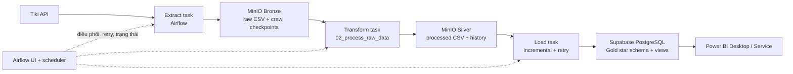

# Tiki Analytics — ETL local với Airflow, MinIO và Supabase

Dữ liệu đi theo một luồng duy nhất: **Tiki → Crawl → MinIO Bronze → Transform → MinIO Silver → Supabase PostgreSQL Gold/Data Mart → Power BI**. Airflow local điều phối lịch chạy và retry; PostgreSQL phụ thuộc Airflow chỉ lưu metadata vận hành, không phải kho phân tích.

## Kiến trúc



**MinIO và Supabase có hai vai trò khác nhau.** MinIO lưu các object CSV/JSON trung gian theo vùng `current/bronze`, `current/silver`, `current/state` và giữ bản cũ dưới `history/<run-id>/...`. Supabase PostgreSQL là kho dữ liệu phục vụ truy vấn/Power BI. Postgres riêng trong Docker chỉ lưu metadata của Airflow (DAG runs, task state, retry); nó không phải database phân tích.

Mô hình hiện tại là **medallion-inspired**: Bronze là dữ liệu crawl, Silver là CSV đã làm sạch, Gold là các bảng phân tích trong Supabase. Đây chưa phải Iceberg lakehouse: CSV vẫn là định dạng tệp; có thể học thêm Parquet/Iceberg và query optimization ở giai đoạn sau.

## Thư mục chính

| Thư mục | Vai trò |
|---|---|
| `01_craw_data/` | Extract: crawler và dữ liệu raw/bootstrap hiện có. |
| `02_process_raw_data/` | Transform: chuẩn hóa dữ liệu, lọc ngày/tháng và tạo CSV sạch. |
| `03_push_to_sql/` | Load: schema, nạp incremental vào Supabase, checkpoint và log. |
| `04_orchestration/airflow/` | Orchestration duy nhất: Airflow local, MinIO Bronze/Silver và checkpoint. |

## Các bảng Supabase: bảng, dòng và cột là gì?

- **Bảng** là một tập bản ghi cùng loại, ví dụ `fact_daily_price` chứa lịch sử giá.
- **Dòng (row)** là một quan sát/bản ghi. Một dòng `fact_daily_price` đại diện cho một sản phẩm/biến thể tại một ngày crawl.
- **Cột (column)** là thuộc tính của bản ghi, ví dụ `crawl_date`, `price`, `seller_product_id`.
- **Khóa chính/khóa duy nhất** xác định một dòng để tránh nạp trùng. Loader đọc các khóa đã có trong PostgreSQL; unique constraint và `ON CONFLICT DO NOTHING` là lớp bảo vệ bổ sung.

| Bảng | Ý nghĩa của một dòng | Cột/khóa quan trọng |
|---|---|---|
| `dim_category` | Một danh mục Tiki. | `category_id` là mã danh mục; các cột tên/mô tả mô tả danh mục. |
| `dim_sub_category` | Một danh mục con. | `category_id` liên kết danh mục cha. |
| `dim_product_listing` | Một sản phẩm được liệt kê trong danh mục tại snapshot tháng. | `product_id`, `seller_product_id`, `category_id`, `crawl_date` (`YYYY-MM`). |
| `product_detail` | Thông tin chi tiết sản phẩm/biến thể tại snapshot tháng. | `product_id`, `crawl_date`; các cột còn lại là tên, thuộc tính, mô tả và chỉ số sản phẩm thu thập được. |
| `dim_product` | Trạng thái dimension hiện tại, một dòng cho mỗi `product_id`. | `product_id`; được đồng bộ từ snapshot mới nhất. |
| `product_seller` | Một liên kết sản phẩm–gian hàng tại snapshot tháng. | product/seller IDs và `crawl_date`. |
| `product_category_map` | Liên kết sản phẩm–danh mục tại snapshot tháng. | `product_id`, `category_id`, `crawl_date`. |
| `fact_daily_price` | Giá/chỉ số bán của một biến thể tại một ngày. | `product_id`, `seller_product_id`, `crawl_date` (`YYYY-MM-DD`), `price`, `list_price`. |
| `fact_review` | Một đánh giá của người mua cho biến thể sản phẩm. | khóa kết hợp `review_id`, `product_id`, `seller_product_id`; thêm `rating`, nội dung và thời điểm đánh giá. |

Hai view `vw_daily_price_analysis` và `vw_review_analysis` bổ sung thuộc tính sản phẩm để Power BI truy vấn thuận tiện. Chi tiết đầy đủ kiểu dữ liệu/cột/constraint nằm tại [`03_push_to_sql/create_database/create_tables_postgres.sql`](03_push_to_sql/create_database/create_tables_postgres.sql) và [`03_push_to_sql/README.md`](03_push_to_sql/README.md).

## Chạy toàn bộ stack local bằng Docker Desktop

**Điều kiện:** Windows có Docker Desktop chạy với WSL 2; đủ RAM/đĩa cho Airflow, PostgreSQL metadata và dữ liệu crawl. Máy phải bật và Docker Desktop phải chạy thì lịch local mới hoạt động. Cài MinIO AIStor Free license trước khi bật stack; xem hướng dẫn ở [`04_orchestration/airflow/README.md`](04_orchestration/airflow/README.md). MinIO hiện yêu cầu license kể cả Free Tier; Community image cũ không còn là lựa chọn prebuilt được bảo trì.

1. Mở PowerShell tại repo và vào thư mục orchestration:

   ```powershell
   cd 04_orchestration/airflow
   Copy-Item .env.example .env
   ```

2. Mở `.env`, tạo mật khẩu local riêng và điền `SUPABASE_DB_URL`. Không dùng/đưa credential vào README, chat hoặc Git. Tải license AIStor Free và đặt tại `04_orchestration/airflow/minio.license`.

3. Khởi tạo Airflow và khởi chạy dịch vụ:

   ```powershell
   docker compose build
   docker compose up airflow-init
   docker compose up -d
   docker compose ps
   ```

4. Mở Airflow tại [http://localhost:8080](http://localhost:8080), đăng nhập bằng `AIRFLOW_ADMIN_USER` và `AIRFLOW_ADMIN_PASSWORD` trong `.env`. MinIO Console ở [http://localhost:9001](http://localhost:9001); S3 API nội bộ của Compose là `http://minio:9000`.

5. Tạo bucket tên `MINIO_BUCKET` trong Console (nếu chưa có). Tạo access key riêng cho ứng dụng và cập nhật `MINIO_ACCESS_KEY`/`MINIO_SECRET_KEY` trong `.env`, sau đó khởi động lại Airflow: `docker compose up -d --force-recreate airflow-webserver airflow-scheduler`. MinIO root credential chỉ nên dùng để thiết lập local.

6. Nạp dữ liệu Git/LFS hiện có vào MinIO một lần, nếu đây là lần đầu:

   ```powershell
   docker compose run --rm airflow-webserver python /opt/tiki/project/04_orchestration/airflow/scripts/minio_task.py bootstrap
   ```

7. Tạo các bảng trong Supabase một lần: mở **SQL Editor** và chạy `03_push_to_sql/create_database/create_tables_postgres.sql`.

8. Trong Airflow bật DAG `tiki_extract_transform_load`. Để chạy thủ công, chọn **Trigger DAG w/ config** và nhập JSON, ví dụ `{"task":"daily_price"}`, `{"task":"product"}`, `{"task":"review"}`, `{"task":"preprocess"}` hoặc `{"task":"push"}`. Có thể trigger qua PowerShell:

   ```powershell
   docker compose exec airflow-scheduler airflow dags trigger --conf '{"task":"daily_price"}' tiki_extract_transform_load
   ```

   Một lượt crawl thủ công cũng chạy transform và load; `preprocess` chạy transform rồi load, còn `push` chạy lại transform trước khi load. Lượt 21:00 tự động chạy transform sau 22:00 và load sau 23:00 nếu các bước trước thành công. Task lỗi được retry tối đa 2 lần. Trigger DAG không cấu hình không chọn nhánh thủ công; hãy dùng cấu hình JSON hoặc chờ lịch tự động.

9. Xác nhận số dòng trong Supabase và mở Power BI để Refresh. Chọn các bảng `dim_*`, `fact_*`, `product_*` phù hợp hoặc bắt đầu với hai view analysis. Không bật DirectQuery song song hàng loạt với pooler giới hạn kết nối; dùng Import/refresh tuần tự để tránh `max clients reached`.

### Kết nối Power BI sau khi có dữ liệu

Trong Power BI Desktop chọn **Trang chủ → Tải dữ liệu → Cơ sở dữ liệu PostgreSQL**. Lấy Host/Port từ Supabase **Connect → PostgreSQL**; database thường là `postgres`. Chọn chế độ **Import** để giảm số kết nối đang mở, rồi nhập user `postgres` và database password khi được hỏi. Bật SSL theo yêu cầu của Supabase (nếu connector hiển thị tùy chọn SSL thì chọn Require). Chọn các bảng `dim_category`, `dim_sub_category`, `dim_product`, `dim_product_listing`, `product_detail`, `product_seller`, `product_category_map`, `fact_daily_price`, `fact_review` hoặc hai view analysis, sau đó chọn **Tải**. Xem hướng dẫn chi tiết và xử lý pooler trong [`03_push_to_sql/README.md`](03_push_to_sql/README.md).

Airflow local là scheduler duy nhất. CSV snapshot hiện có trong repository là dữ liệu mẫu/khởi tạo (hai CSV review lớn dùng Git LFS); các lần crawl và checkpoint phát sinh được lưu trong MinIO, không tự commit/push ngược về GitHub.

Lệnh vận hành thường dùng (PowerShell, tại `04_orchestration/airflow`):

```powershell
docker compose ps
docker compose logs -f airflow-scheduler
docker compose logs -f minio
docker compose down
```

`docker compose down` giữ dữ liệu trong named volumes. Không chạy `docker compose down -v` nếu chưa định xóa hoàn toàn metadata Airflow và object MinIO.

## Lịch DAG (Asia/Bangkok)

| DAG | Lịch | Công việc |
|---|---|---|
| `tiki_extract_transform_load` | DAG kiểm tra lúc 02:00, 10:00, 21:00 | 21:00 crawl giá; ngày cuối tháng 02:00/10:00 crawl product; mùng 1 02:00/10:00 crawl review. |
| Chuỗi cuối ngày trong cùng DAG | Sau crawl giá lúc 21:00 | Chờ 22:00 → preprocess → chờ 23:00 → push Supabase. |

Các lượt product/review lần hai là lượt crawl bổ sung theo lịch riêng; khả năng lặp lại an toàn nhờ checkpoint/key chống trùng. Airflow retry tự thử lại task bị lỗi theo cấu hình, không phụ thuộc lượt lịch kế tiếp.

## Phạm vi và giới hạn hiện tại

- Adapter MinIO giữ một object `current` cho trạng thái làm việc và lưu phiên bản cũ khi nội dung thay đổi. Nó chỉ tải các nhóm dữ liệu cần cho từng task để tránh tải toàn bộ review ở mỗi lượt.
- Crawler hiện vẫn làm việc trên CSV. Với một file CSV lớn, mỗi lần file thay đổi vẫn phải tải/lưu lại toàn object; có thể cải thiện bằng phân vùng theo ngày/tháng và Parquet. Chưa có Iceberg table/compaction/query optimization trong phiên bản này.
- Supabase loader nạp các row mới; MinIO history là bản lưu tệp trước/sau thay đổi, không phải backup point-in-time database. Sao lưu Supabase riêng nếu cần khôi phục DB.
- Cấu hình Docker này phục vụ học tập/local, không phải triển khai production. Lịch ngừng chạy khi máy hoặc Docker Desktop tắt; project không tự chạy bù các lượt bị lỡ.
