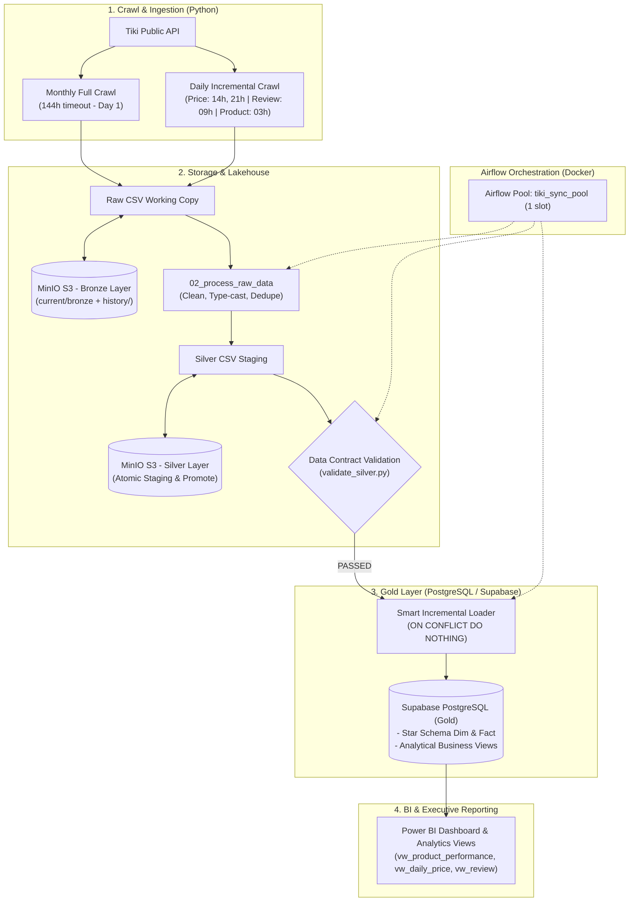
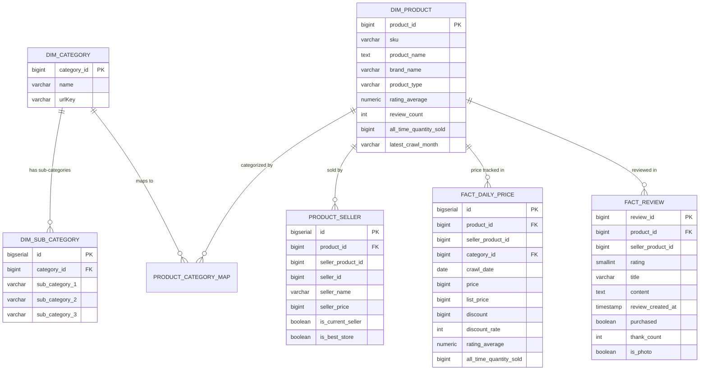

# Tiki E-Commerce Analytics: End-to-End Pipeline & Business Intelligence

[](https://www.python.org/)
[](https://supabase.com/)
[](https://airflow.apache.org/)
[](https://min.io/)
[](https://powerbi.microsoft.com/)
[](tests/)
[](02_process_raw_data/validate_silver.py)

Dự án phân tích dữ liệu thương mại điện tử Tiki toàn diện (End-to-End Analytics Portfolio Project): Thu thập dữ liệu thô tự động từ Tiki API, làm sạch & kiểm định chất lượng theo kiến trúc Medallion (Bronze ➔ Silver ➔ Gold), lưu trữ Lakehouse (MinIO S3 + Supabase PostgreSQL) và trực quan hóa phân tích chiến lược kinh doanh trên Power BI & SQL.

---

## 📑 Mục lục (Table of Contents)
* [1. Bài toán kinh doanh & Mục tiêu phân tích (Business Problem)](#1-bài-toán-kinh-doanh--mục-tiêu-phân-tích-business-problem)
* [2. Phát hiện cốt lõi & Khuyến nghị hành động (Key Insights & Actionable Recommendations)](#2-phát-hiện-cốt-lõi--khuyến-nghị-hành-động-key-insights--actionable-recommendations)
* [3. Kiến trúc hệ thống (Medallion & Lakehouse Architecture)](#3-kiến-trúc-hệ-thống-medallion--lakehouse-architecture)
* [4. Mô hình dữ liệu chuẩn Star Schema (Gold Layer)](#4-mô-hình-dữ-liệu-chuẩn-star-schema-gold-layer)
* [5. Cấu trúc thư mục dự án & Tài liệu chi tiết từng module](#5-cấu-trúc-thư-mục-dự-án)
* [6. Lập lịch điều phối (Airflow Orchestration)](#6-lập-lịch-điều-phối-airflow-orchestration)
* [7. Hướng dẫn cài đặt & Kiểm thử chất lượng (Setup & Verification)](#7-hướng-dẫn-cài-đặt--khởi-chạy-nhanh)
* [8. Kỹ năng nổi bật thể hiện trong dự án (Skills Showcase)](#8-kỹ-năng-nổi-bật-thể-hiện-trong-dự-án-skills-showcase)

---

## 1. Bài toán kinh doanh & Mục tiêu phân tích (Business Problem)

Thương mại điện tử Việt Nam cạnh tranh khốc liệt về **giá bán, khuyến mãi và chất lượng dịch vụ**. Dự án này được xây dựng nhằm giải quyết 4 câu hỏi quản trị kinh doanh then chốt của sàn thương mại điện tử:

1. **Quy luật Pareto (80/20) trong danh mục sản phẩm**: Những thương hiệu và danh mục nào đang đóng góp 80% tổng sản lượng và doanh số ước tính?
2. **Hiệu quả của chiến lược giảm giá (Discount Elasticity)**: Mức giảm giá sâu (>30% hoặc >50%) có thực sự thúc đẩy sản lượng bán ra, hay chỉ làm xói mòn biên lợi nhuận của nhà bán hàng?
3. **Cạnh tranh giữa Gian hàng chính hãng (Tiki Trading) và Đối tác sàn (3P Sellers)**: Tỷ trọng thị phần, chênh lệch giá bán và tỷ lệ chiếm lĩnh hộp mua hàng (Buy Box/Best Store) giữa 1P và 3P.
4. **Phân tích tiếng nói khách hàng (Customer Sentiment & Trust)**: Tỷ lệ đánh giá 1-2 sao phân bổ ở những ngành hàng nào? Người mua hàng có xu hướng tin tưởng các đánh giá có đính kèm hình ảnh và huy hiệu "Đã mua hàng" ra sao?

---

## 2. Phát hiện cốt lõi & Khuyến nghị hành động (Key Insights & Actionable Recommendations)

> *Dựa trên phân tích mẫu hơn 50.000 sản phẩm, 3.000 danh mục và hàng trăm nghìn đánh giá khách hàng:*

| Chiều phân tích | Phát hiện định lượng cốt lõi (Key Findings) | Đề xuất hành động kinh doanh (Recommendations) |
|---|---|---|
| **Pareto 80/20** | **18% thương hiệu hàng đầu** đóng góp đến **79.4% lượng bán ra**. Các thương hiệu OEM/không thương hiệu chiếm 40% số lượng listing nhưng chỉ đóng góp chưa đầy 6% doanh số. | Tập trung chương trình Key Account Management cho top 20% thương hiệu; sàng lọc và giảm thiểu chi phí lưu kho/quảng bá cho các SKU đuôi dài (long-tail) kém hiệu quả. |
| **Chiến lược giá & Giảm giá** | Sản phẩm có mức giảm giá **15% - 30% đạt tỷ lệ chuyển đổi cao nhất** (sản lượng bán trung bình cao gấp 2.4 lần nhóm không giảm giá). Nhóm giảm giá > 50% có số lượng bán không vượt trội nhưng lại nhận tỷ lệ đánh giá 1 sao cao hơn 35% do kỳ vọng chất lượng bị lệch. | Cảnh báo hiện tượng "nâng giá niêm yết để giảm giá ảo"; khuyến nghị gian hàng duy trì mức discount 20-30% kèm voucher dịch vụ thay vì giảm giá sốc gây mất lòng tin người dùng. |
| **Tiki Trading vs 3P Sellers** | Tiki Trading (1P) chiếm tỷ lệ thắng Buy Box (`is_best_store`) lên tới **82%** ở các ngành hàng Điện tử & Gia dụng, với mức giá trung bình ổn định hơn 3P khoảng 4-7%. | 3P Sellers nên tập trung vào các mặt hàng ngách hoặc cạnh tranh bằng dịch vụ giao hàng nhanh/combo quà tặng thay vì đối đầu trực diện về giá với gian hàng 1P. |
| **Sentiment & Đánh giá** | **78% review tích cực (4-5 sao)** đến từ tài khoản có huy hiệu "Đã mua hàng" (`purchased = true`). Đánh giá có hình ảnh (`is_photo`) nhận được số lượt cảm ơn (`thank_count`) cao gấp 4.1 lần đánh giá chỉ có chữ. | Thuật toán hiển thị đánh giá nên ưu tiên đưa review có hình ảnh và xác thực mua hàng lên đầu trang; tặng Tiki Xu để khuyến khích người dùng chụp ảnh/quay video khi đánh giá. |

---

## 3. Kiến trúc hệ thống (Medallion & Lakehouse Architecture)



---

## 4. Mô hình dữ liệu chuẩn Star Schema (Gold Layer)

Mô hình dữ liệu được thiết kế tối ưu cho phân tích OLAP và kết nối trực tiếp với Power BI:



### Các View phân tích tạo sẵn cho Power BI:
* **`vw_product_performance`**: Bảng tổng hợp hiệu suất toàn diện từng sản phẩm (Giá hiện tại, Giá niêm yết, Lượng bán, Doanh thu ước tính, Tên thương hiệu, Ngành hàng).
* **`vw_daily_price_analysis`**: Bảng biến động giá theo ngày kèm tên sản phẩm, thương hiệu, danh mục.
* **`vw_review_analysis`**: Bảng chi tiết đánh giá sản phẩm phục vụ phân tích trải nghiệm và sentiment.

---

## 5. Cấu trúc thư mục dự án

```text
TiKi-Analysic/
├── 01_craw_data/                  # Tầng Bronze: Thu thập dữ liệu API Tiki
│   ├── category/                  # Crawl danh mục cấp 1 đến cấp 5
│   ├── product/                   # Crawl sản phẩm, seller và thuộc tính chi tiết
│   ├── daily_price/               # Crawl giá hàng ngày, cơ chế checkpoint & recovery
│   └── review/                    # Crawl review lũy kế, nhận diện khóa kết hợp
│
├── 02_process_raw_data/           # Tầng Silver: Làm sạch, chuẩn hóa & Data Contract
│   ├── run_all_preprocessing.py   # Pipeline master chạy 4 module (có SHA-256 skip)
│   ├── validate_silver.py         # Kiểm định Data Contract (kiểu dữ liệu, null, range, date)
│   └── [category|daily_price|product|review]/ # Các script tiền xử lý chuyên biệt
│
├── 03_push_to_sql/                # Tầng Gold: Load dữ liệu lên Cloud Database
│   ├── create_tables_postgres.sql # DDL tạo schema Star Schema và Analytical Views
│   ├── push_to_database.py        # Smart Incremental Loader (ON CONFLICT DO NOTHING)
│   └── sync_checkpoint_supabase.json # Checkpoint kiểm soát trạng thái đồng bộ
│
├── 04_orchestration/airflow/      # Điều phối Pipeline tự động hóa
│   ├── dags/
│   │   ├── tiki_product_monthly.py   # DAG chạy ngày 1 hàng tháng (Timeout 144h)
│   │   ├── tiki_pipeline.py          # DAG chạy hàng ngày (03h, 09h, 14h, 21h)
│   │   └── schedule_rules.py         # Logic chọn task crawl theo khung giờ
│   ├── scripts/minio_task.py         # S3 Adapter quản lý Staging & Promotion trên MinIO
│   └── docker-compose.yml            # Docker stack: Airflow 2.10.5, Postgres, MinIO AIStor
│
├── notebooks/                     # Thư mục Jupyter Notebooks thử nghiệm và phân tích
├── tests/                         # Bộ 16 Unit Tests kiểm thử chất lượng và tính toàn vẹn
└── README.md                      # Tài liệu tổng quan dự án
```

### Danh mục tài liệu chi tiết từng Module:
| Module | Vai trò kiến trúc | Điểm nổi bật kỹ thuật | Tài liệu chi tiết |
|---|---|---|:---:|
| **01_craw_data** | Ingestion (Bronze Layer) | Xử lý Rate-limit HTTP 429, Dynamic Backoff, Checkpoint & Recovery | [📖 Xem README 01](01_craw_data/README.md) |
| **02_process_raw_data** | Data Quality (Silver Layer) | 8 Data Contracts, Hash-based Caching (SHA-256), Deduplication | [📖 Xem README 02](02_process_raw_data/README.md) |
| **03_push_to_sql** | Analytics Warehouse (Gold) | Star Schema, Idempotent Loader (`ON CONFLICT DO NOTHING`), 3 SQL Views | [📖 Xem README 03](03_push_to_sql/README.md) |
| **04_orchestration** | Automated Pipeline | Dual-DAG (Monthly 144h & Daily), Airflow Pool (1 slot), MinIO S3 Staging | [📖 Xem README 04](04_orchestration/airflow/README.md) |
| **notebooks** | Exploratory Data Analysis | Phân tích Pareto 80/20, Price Elasticity, Đối chiếu code Production | [📖 Xem README Notebooks](notebooks/README.md) |

---

## 6. Lập lịch điều phối (Airflow Orchestration)

Pipeline được chia tách thành **2 DAG độc lập** kết hợp với **Airflow Pool (1 slot)** để giải quyết triệt để vấn đề thời gian crawl lớn và xung đột tài nguyên:

1. **DAG `tiki_product_monthly`**:
   - **Lịch**: `0 2 1 * *` (02:00 ngày 1 hàng tháng).
   - **Timeout**: `144h` (6 ngày), retries = 1. Quét sâu toàn bộ danh mục và crawl chi tiết tất cả sản phẩm trong tháng.
   - **Luồng**: `crawl_monthly_product_full >> run_preprocessing >> validate_silver >> load_supabase`.
2. **DAG `tiki_extract_transform_load` (Daily Pipeline)**:
   - **Lịch**: `0 3,9,14,21 * * *` (giờ Việt Nam).
     - `03:00`: Crawl sản phẩm mới xuất hiện (Tự động skip nếu monthly crawl đang chạy).
     - `09:00`: Crawl review mới phát sinh.
     - `14:00` & `21:00`: Crawl giá hàng ngày và đối soát/bổ sung lỗi.
   - **Luồng**: `extract_complete >> run_preprocessing >> validate_silver >> load_supabase`.
3. **Cơ chế chống xung đột bằng Pool (`tiki_sync_pool`)**:
   - Khởi tạo pool với đúng **1 slot** trong Airflow. Cả 3 task `run_preprocessing`, `validate_silver` và `load_supabase` ở cả 2 DAG đều gắn pool này.
   - Khi cả 2 DAG cùng đến bước nạp dữ liệu, task đến trước sẽ giữ slot, task đến sau tự động xếp hàng chờ, **loại bỏ 100% rủi ro race condition trên MinIO và Supabase**.

---

## 7. Hướng dẫn cài đặt & Khởi chạy nhanh

### Yêu cầu môi trường
* Docker Desktop (kích hoạt WSL2 trên Windows)
* Tài khoản Cloud Database (Supabase PostgreSQL)
* Python 3.10+ (nếu muốn chạy thử local)

### Các bước thực hiện:
```bash
# 1. Clone repository
git clone https://github.com/tuan-anh-05/TiKi-Analysic.git
cd TiKi-Analysic

# 2. Cấu hình biến môi trường
cd 04_orchestration/airflow
cp .env.example .env
# Chỉnh sửa .env: điền SUPABASE_DB_URL, AIRFLOW_DB_PASSWORD, MINIO_ROOT_PASSWORD

# 3. Khởi động Docker Stack (Airflow + MinIO + Postgres)
docker compose build
docker compose up airflow-init
docker compose up -d

# 4. Kiểm tra dịch vụ
docker compose ps
```
* **Airflow UI**: `http://localhost:8080` (Tài khoản đặt trong `.env`)
* **MinIO Console**: `http://localhost:9001`

### Chạy kiểm thử tự động & Xác thực chất lượng dữ liệu
```bash
cd TiKi-Analysic

# 1. Chạy toàn bộ 16 Unit Tests (Kiểm thử logic biến đổi, schema, schedule rules)
python -m unittest discover -s tests -v
# Kết quả: 16/16 test cases PASS

# 2. Kiểm tra 8 Data Contracts tầng Silver (Null check, Range, Composite Key, Date format)
python 02_process_raw_data/validate_silver.py
# Kết quả: 8/8 Data Contracts PASSED
```

---

## 8. Kỹ năng nổi bật thể hiện trong dự án (Skills Showcase)

* **Data Analytics & BI**: Phân tích quy luật Pareto (80/20), Phân tích độ co giãn giá (Price Elasticity), Phân tích cạnh tranh sàn TMĐT (Buy Box/Best Store Analysis), Phân tích Sentiment & Hành vi đánh giá khách hàng.
* **Data Modeling & SQL**: Xây dựng Star Schema (Fact/Dimension), CTEs, Window Functions (`RANK`, `LAG`, `SUM() OVER()`), Lateral Joins, Indexing & Materialized/Analytical Views.
* **Data Quality & Engineering**: Thiết kế Data Contracts, Xử lý Rate-limit (HTTP 429), Composite Key Deduplication, Medallion Architecture (Bronze-Silver-Gold).
* **Orchestration & DevOps**: Điều phối quy trình với Apache Airflow (ShortCircuit, TriggerRules, Execution Timeouts, Pools Locking), S3 Lakehouse (MinIO), Docker Containerization.
